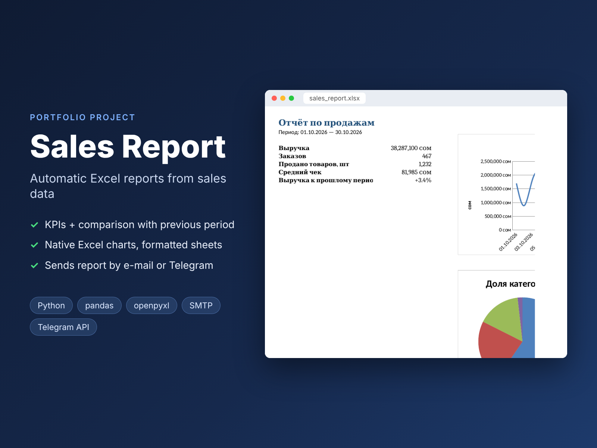

# Sales Report: automatic Excel reports from sales data



A script that turns a raw sales export (CSV) into a ready Excel report with KPIs, charts and breakdowns, and sends it by e-mail or Telegram. It is meant for routine reporting that a manager otherwise builds by hand every week.

> Portfolio project. The demo data is generated (a fictional store). Calculations and the Excel structure are covered by tests.

**Stack:** Python 3.11+ · pandas · openpyxl (native Excel charts) · smtplib · httpx (Telegram Bot API) · pytest

## What the report contains

| Sheet | Content |
|---|---|
| Summary | Revenue, orders, items sold, average check, **change vs. the previous period** + 3 charts |
| By day | Daily revenue and orders (line chart) |
| Categories / Regions | Revenue, orders, items, share (pie and bar charts) |
| Top products | 10 best-selling products |
| Data | Cleaned source rows with autofilter |

All tables have formatted headers, money and percent formats, frozen header rows, autofilters and sensible column widths. The charts are native Excel charts, so the client can edit them.

## Data cleaning

- Checks that the required columns are present: `date, order_id, product, category, region, quantity, price`
- Drops rows with invalid dates or numbers and with zero or negative quantity
- An order with several products counts as **one** order: the average check is revenue / unique orders

## Usage

```bash
pip install -r requirements.txt
python -m report.demo_data                       # demo file data/sales.csv
python -m report --input data/sales.csv --from 2026-10-01 --to 2026-10-31 --out reports/october.xlsx
```

Send the result:

```bash
# e-mail (for Gmail, use an app password)
export SMTP_USER=me@gmail.com SMTP_PASSWORD=app-password
python -m report --input data/sales.csv --email boss@company.kg

# Telegram
export TG_BOT_TOKEN=... TG_CHAT_ID=...
python -m report --input data/sales.csv --telegram
```

To get the report every Monday, a cron job is enough: `0 9 * * 1 cd /path && .venv/bin/python -m report --input ... --telegram`.

## Tests

```bash
pip install -r requirements-dev.txt
pytest -q && ruff check .
```

The tests cover data cleaning, KPIs, comparison with the previous period, groupings and shares, the Excel structure (sheets, charts, filters), CLI errors, the e-mail attachment and the Telegram request.
